# StudyMate

**Turn PDFs, PowerPoints, and lecture videos into one interactive AI study session.**

StudyMate is a multimodal learning experience that turns a student's own course material into a guided lesson. Regina explains source-grounded ideas, synchronizes the relevant PDF or PowerPoint page, answers questions without losing the student's place, and finishes with an adaptive quiz.

## The Problem

Course material is usually fragmented: slide decks in one place, PDFs in another, and recorded lectures elsewhere. Reading them alone is difficult when the important meaning lives in a diagram, example, or explanation rather than in the visible text.

Students can use a generic chatbot, but then they must decide what to ask, keep it on track, and repeatedly explain which file or slide they mean. That makes independent study feel like managing tools instead of learning.

## Our Vision

StudyMate makes a student's own material teachable as one coherent lesson. Rather than treating each file as an isolated upload, it combines sources into a single session with a clear outline, source-aware teaching, natural interruptions, and assessment that responds to the student's understanding.

The long-term goal is a learning companion that can connect lectures, practice, and progress across a whole course while keeping the student in control of the pace and path.

## What StudyMate Does

1. **Combines learning media.** Upload one or more PDFs, PPT/PPTX files, and lecture videos into one session.
2. **Builds a lesson plan.** The AI creates a topic outline, explanation segments, source references, and question checkpoints.
3. **Teaches from the exact source.** Each segment can point to the original PDF/PPT file and page used for the explanation.
4. **Keeps the student involved.** Students can answer AI questions, raise a hand, ask about earlier slides in the same topic, replay topics, and use voice input.
5. **Adapts assessment.** The final quiz uses live teaching mistakes and prior quiz results to focus new questions on weak areas.

## Screenshots

### Home

<p align="center">
  <a href="screenshots/homepage.png">
    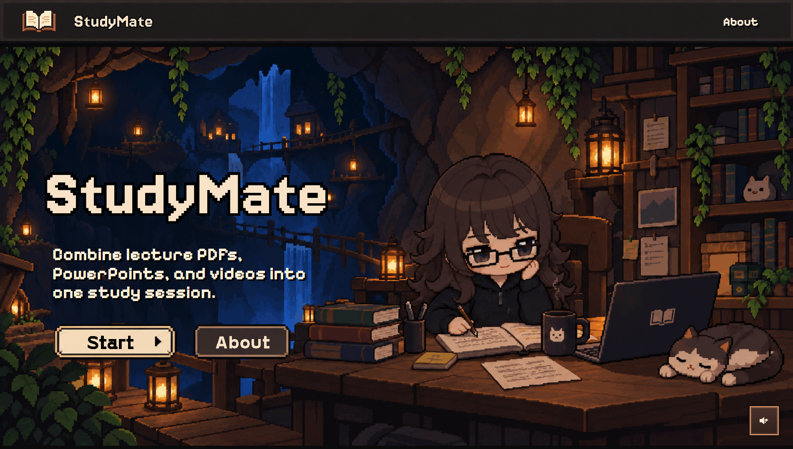
  </a>
</p>

### Getting Started

| Upload media | Choose an environment |
|:---:|:---:|
| <a href="screenshots/uploadpage.png">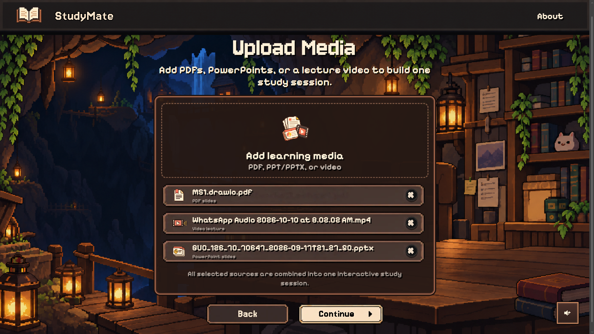</a> | <a href="screenshots/chooseenviromentpage.png">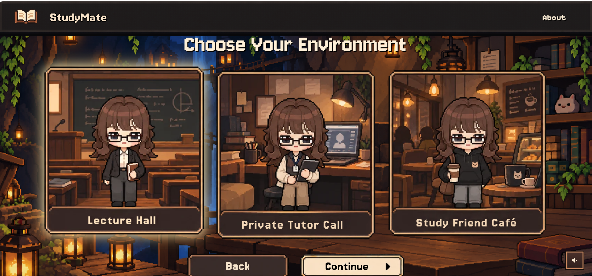</a> |

### Learning Environments

| Lecture Hall | Private Tutor | Study Cafe |
|:---:|:---:|:---:|
| <a href="screenshots/lecturehallpage.png">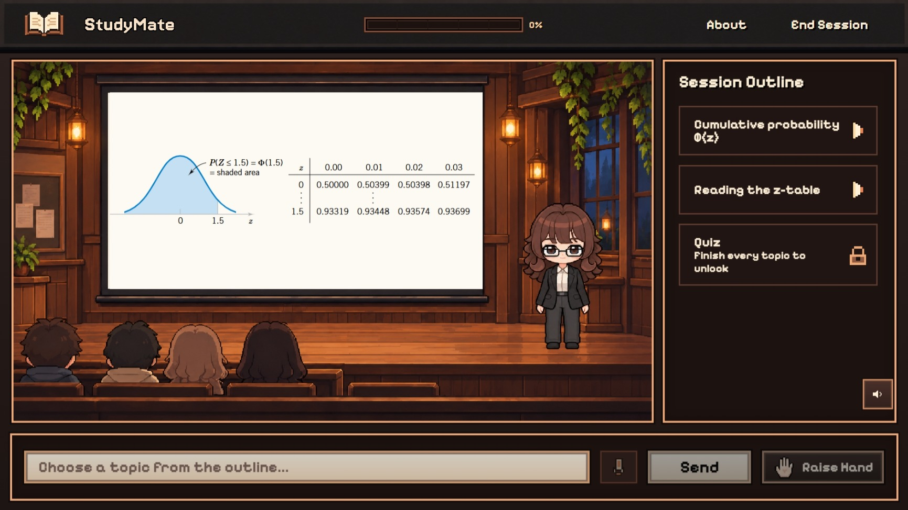</a> | <a href="screenshots/privatetutorpage.png">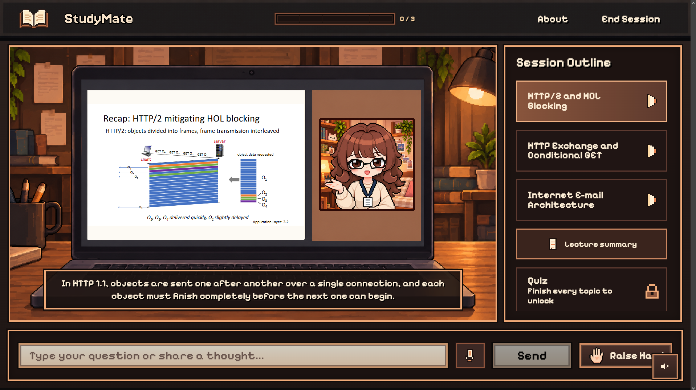</a> | <a href="screenshots/cafepage.png">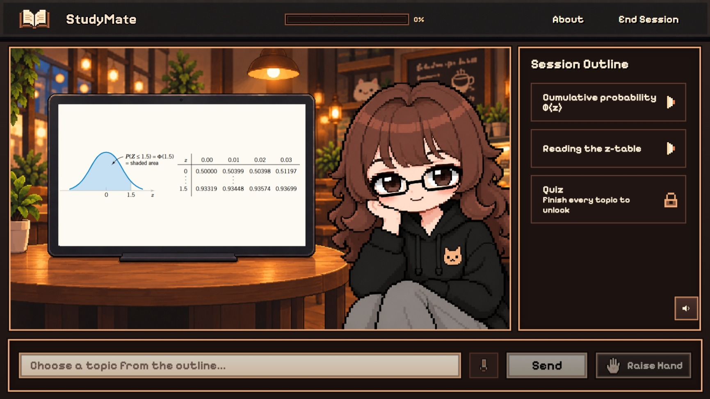</a> |

*Click a screenshot to view it at full size.*

## Demo Video

https://youtu.be/hD6jDxHqO9k

## Architecture Overview

The React frontend renders the session and sends user actions to FastAPI. The backend normalizes all uploaded media into `LectureChunk` records, then LangGraph uses one session-specific `TeacherState` to control planning, teaching, questions, progress, and recovery after an interruption.

The frontend is driven by `TeacherResponse`: Regina's current speech, the source file and page to display, the current mode, available input, topic progress, and quiz availability. Lesson decisions remain on the backend.

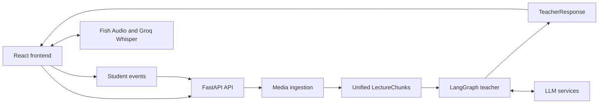

### Media Ingestion

| Source | Processing path | Preserved reference |
|---|---|---|
| PDF | PyMuPDF extracts each page. Pages with diagrams, drawings, images, or little text are also visually interpreted by the LLM. | File name, source index, page number |
| PPT/PPTX | Converted to PDF, then processed through the same PDF pipeline. | File name, source index, slide number |
| Video | FFmpeg extracts audio, then Groq Whisper returns timestamped transcript segments. | File name, source index, start/end timestamps |

All resulting chunks are merged in upload order. Each one receives a global slide ID for the lesson flow while retaining its original file and page/timestamp metadata. Visual PDF and converted-PPT sources are cached for the in-session viewer.

## LangGraph State

`TeacherState` is the backend's source of truth for one active learning session. LangGraph saves it under the session ID after every graph step using a `MemorySaver` checkpoint.

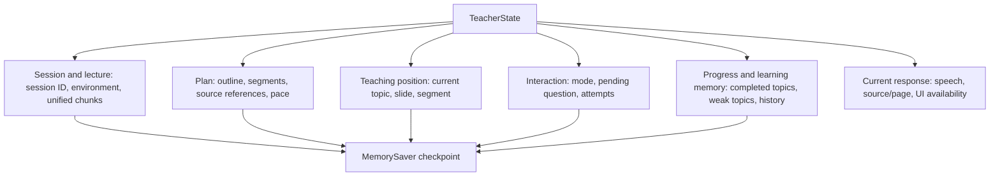

The state tracks the lesson itself, where the student is in it, what the tutor is waiting for, and what the student has found difficult. The UI renders the response produced from that state instead of recreating lesson logic.

## Workflow 1: Starting and Running a Session

1. The frontend sends selected media and the chosen environment to `POST /api/sessions`.
2. The backend processes every file and creates one ordered lecture of `LectureChunk`s.
3. `Teacher.start_session()` creates a session ID and initializes `TeacherState`.
4. The LangGraph `plan` node creates the opening, outline, topic segments, source references, teaching pace, and question checkpoints.
5. The graph returns the opening response, then pauses at `wait`.
6. The frontend plays Regina's speech, displays the referenced source page, and sends events back as the student interacts.

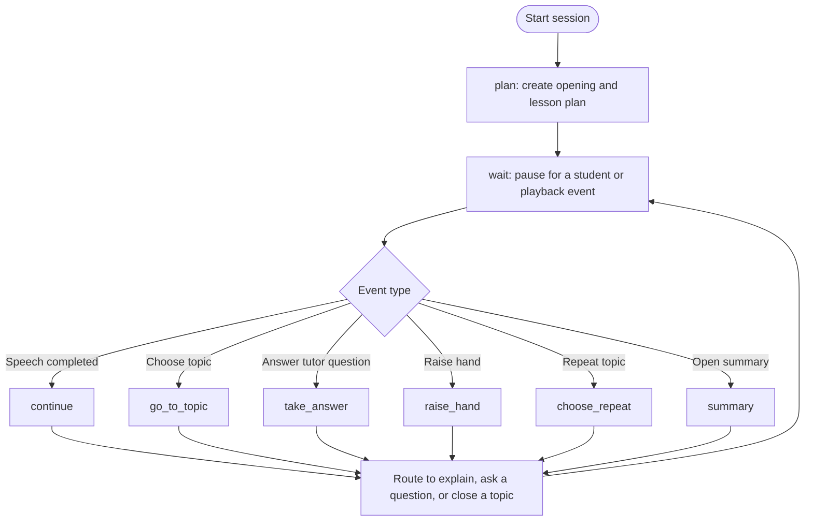

The graph validates every event against the current mode. For example, an answer is only accepted when Regina has asked a question, and a hand can only be raised while she is explaining.

## Workflow 2: Tutor Questions and Student Answers

Each topic is broken into explanation segments. The planning stage marks natural places to pause and check understanding. When a segment group reaches a checkpoint, LangGraph creates a `pending_question` containing the question, expected answer, and explanation needed for feedback.

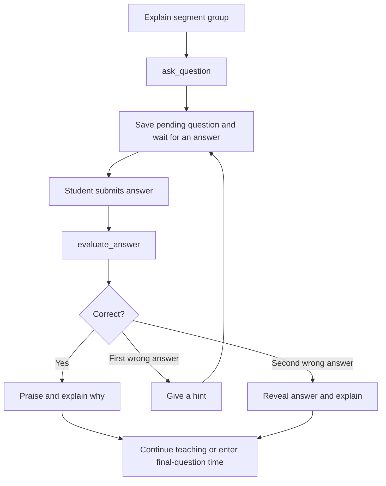

The tutor accepts equivalent wording, not only exact strings. A first incorrect answer gives a hint and retry; a second incorrect answer reveals the answer. Any incorrect attempt adds that topic to `topics_to_improve`, which later informs the quiz.

At the end of a topic, Regina opens final-question time and keeps it open until the student says they have no more questions. The topic is only then marked complete.

## Workflow 3: Student Questions During a Lesson

The raise-hand flow preserves the interrupted teaching position instead of abandoning the lesson.

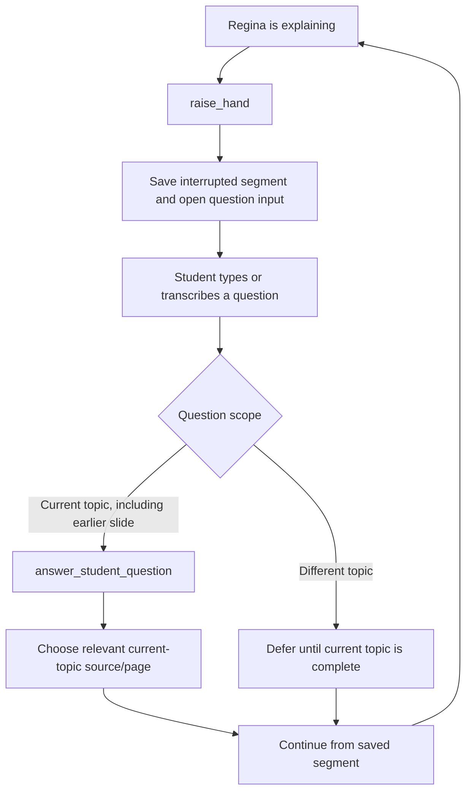

For a same-topic question, the AI receives the current topic's source material and recent conversation. It may select an earlier source slide/page, the viewer switches to that source, and Regina answers as if she is looking at it. Afterward, the normal explanation resumes from the saved segment.

If the student asks about a different topic, Regina defers it until the current topic is complete and directs the student to choose that topic from the outline. Voice questions follow the same path after Groq Whisper places an editable transcript in the text input.

## Workflow 4: Adaptive Quiz, Submission, and Retakes

The quiz is deliberately stored outside the LangGraph teaching loop because it does not change lecture progress. Each session has a `QuizRecord` that holds the active questions, attempt number, previous questions, and missed topics.

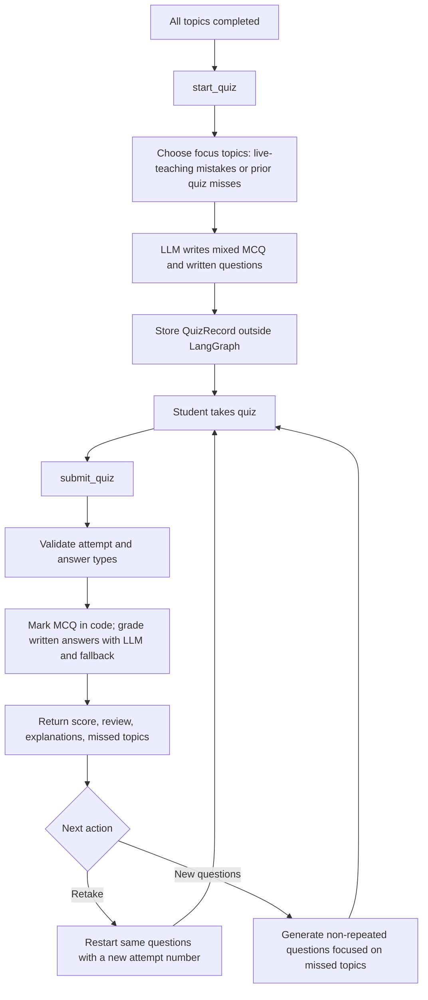

The first quiz uses topics where the student struggled during teaching. New quizzes use topics missed in the most recently submitted quiz and avoid repeating older questions. Retake keeps the same questions but resets the attempt. Multiple-choice answers are marked directly; written answers are graded against the model answer, with a keyword fallback if AI grading is unavailable.

## Technology

- **Frontend:** React, Vite, JavaScript, CSS, PDF.js
- **Backend:** Python, FastAPI, Pydantic, HTTPX
- **Agent orchestration:** LangGraph with `MemorySaver`
- **Document processing:** PyMuPDF, LibreOffice or PowerPoint export for presentations
- **Video processing:** FFmpeg through `imageio-ffmpeg`, Groq Whisper transcription
- **AI teaching and planning:** Featherless AI
- **Tutor speech:** Fish Audio

## Deployment

- **Frontend:** Deployed with Vercel
- **Backend API:** Deployed with Render

## What's Next

StudyMate currently creates one source-aware learning session from a student's uploaded PDFs, PowerPoints, and lecture videos. The next step is to make that support continuous across an entire course.

- **Course memory:** Organize sessions into courses so the tutor can connect a new lecture to earlier material and remember what the student has already covered.
- **Long-term learning profile:** Carry quiz performance, misconceptions, and practice results across sessions to personalize review and pacing over time.
- **More study modes:** Extend the same source-grounded workflow to worksheets, practice problems, and revision sessions.
- **More learner choice:** Add more environments, tutor voices, and teaching styles while retaining the same lesson state and source references.

## Run Locally

### Requirements

- Python 3.10+ and Node.js 20+
- A Featherless AI API key for slide understanding, planning, teaching, and quiz generation
- A Fish Audio API key for Regina's speech
- A Groq API key for video transcription and optional microphone input
- LibreOffice is recommended for faithful PPT/PPTX conversion. A legacy `.ppt` file requires LibreOffice or a local PowerPoint installation; `.pptx` has a text-only fallback.

### 1. Clone the repository

```bash
git clone https://github.com/bushramagdy3/StudyMate.git
cd StudyMate
```

### 2. Configure and run the backend

```bash
cd backend
python -m venv venv
```

Activate the virtual environment:

- Windows PowerShell: `venv\Scripts\Activate.ps1`
- Windows Command Prompt: `venv\Scripts\activate.bat`
- macOS/Linux: `source venv/bin/activate`

Install dependencies:

```bash
python -m pip install -r requirements.txt
```

Create `backend/.env`:

```env
FEATHERLESS_API_KEY=your_featherless_api_key
FISH_AUDIO_API_KEY=your_fish_audio_api_key
GROQ_STT_API_KEY=your_groq_api_key

# Optional overrides
FEATHERLESS_MODEL=moonshotai/Kimi-K3
FEATHERLESS_CONCURRENCY=2
LIBREOFFICE_PATH=C:\Program Files\LibreOffice\program\soffice.exe
```

Start the API from `backend/`:

```bash
python -m uvicorn main:app --reload
```

The API runs at `http://127.0.0.1:8000`.

### 3. Configure and run the frontend

Open a second terminal in the project root:

```bash
cd frontend
npm install
npm run dev
```

Open the Vite URL shown in the terminal, usually `http://localhost:5173`.

The frontend uses `http://127.0.0.1:8000` by default. To use a different backend URL, add this to `frontend/.env`:

```env
VITE_API_BASE_URL=http://127.0.0.1:8000
```

### API Notes

- **Featherless AI** is required for visual slide interpretation, lesson planning, teaching, question generation, and written-answer grading.
- **Fish Audio** is required for Regina's generated speech.
- **Groq Whisper** is required for video transcription and optional microphone input. Students can still type answers and questions when voice input is unavailable.
